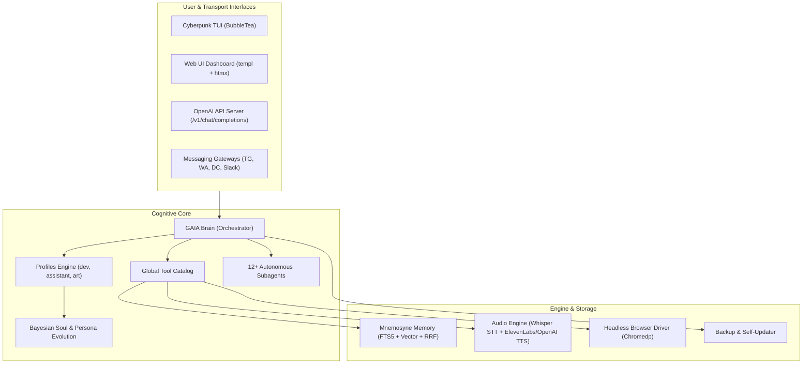

# GAIA — Go Autonomous Intelligence Agent

<p align="center">
  
</p>

[](https://go.dev)
[](https://gaia.facundosalvucci.dev)
[](https://gaia.facundosalvucci.dev/docs)
[](LICENSE)
[](https://github.com/SalvucciFacundo/gaia/releases)
[](https://github.com/SalvucciFacundo/gaia)
[](https://github.com/SalvucciFacundo/gaia/actions)

<p align="center">
  ·
</p>
**GAIA (Go Autonomous Intelligence Agent)** is an enterprise-grade, single-binary autonomous AI assistant and software engineering platform built from the ground up in Go.

GAIA couples autonomous agency with strict operational boundaries:
- **Zero External Runtimes**: Compiles into a single, self-contained native binary with embedded SQLite, FTS5, web assets, templates, and migrations.
- **Organic Driven Development (ODD)**: Dynamically scales from quick inline direct execution to multi-subagent teams without context bloat.
- **Decoupled Architecture**: Profiles define cognitive bias and identity (`SOUL.md`), while tools, multi-channel gateways, and audio engines live in a shared, globally configurable catalog.
- **Omnichannel Access**: Interact via interactive Cyberpunk TUI, built-in Web UI Dashboard (`templ` + `htmx`), OpenAI-compatible REST/SSE API, or native messaging gateways (Telegram, WhatsApp Cloud API, Discord, Slack) with bi-directional voice notes.

---

## ⚡ Quick Start

### 1. One-Line Installation

**Linux & macOS:**
```bash
curl -fsSL https://raw.githubusercontent.com/SalvucciFacundo/gaia/main/install.sh | bash
```

**Windows (PowerShell):**
```powershell
iwr -useb https://raw.githubusercontent.com/SalvucciFacundo/gaia/main/install.ps1 | iex
```

### 2. Build from Source

```bash
git clone https://github.com/SalvucciFacundo/gaia.git
cd gaia
go build -o gaia ./cmd/gaia/
./gaia
```

### 3. First Run Wizard

On first launch, GAIA automatically starts an interactive terminal setup wizard:
- Select your primary LLM provider (OpenAI, Anthropic, DeepSeek, Ollama, Groq, OpenRouter, etc.).
- Choose and activate your starting profile (`dev`, `assistant`, `art`).
- Optionally initialize messaging gateways and audio synthesizers.

---

## 🧩 Architectural Foundations

GAIA is built across **60 modular Go packages** adhering to Hexagonal Architecture (Ports and Adapters):



---

## 🎭 Profiles & Persona Evolution

GAIA separates **who the agent is** from **what the agent can do**.

### Built-in Profiles
- **`dev` (Software Architect)**: Autonomous software engineer specialized in architecture, refactoring, ODD workflows, tests, and Git operations.
- **`assistant` (Personal Assistant)**: Versatile companion for research, synthesis, daily workflows, reminders, and web tasks.
- **`art` (Visual Reasoning & Creative)**: Creative partner focused on design systems, image prompts, aesthetics, and ComfyUI workflows.

### Bayesian Soul Evolution
Every profile maintains a distinct `SOUL.md`. As the agent interacts, the Bayesian soul engine records reinforcement metrics and dynamically refines its operational demeanor while the security scanner detects and rejects prompt injection attempts in real-time.

### Profile CLI Management
```bash
# List all registered profiles and active status
gaia profile list

# Switch active profile
gaia profile switch dev

# Enable or disable profiles
gaia profile enable art
gaia profile disable assistant
```

---

## 🧰 Global Tool Catalog & Per-Profile Decoupling

No tool or gateway is locked to a specific profile. Any profile can be customized to use any combination of tools from the global catalog:

```bash
# List tools available to a profile (both active and available in catalog)
gaia profile tools list dev

# Enable or disable individual tools for a profile
gaia profile tools enable dev browser_navigate
gaia profile tools disable dev exec_command

# Reset profile back to its suggested toolset
gaia profile tools reset dev
```

You can also customize tools declaratively in `config.yaml`:
```yaml
current_profile: "dev"
profiles:
  dev:
    enabled: true
    model: "claude-3-5-sonnet"
    tools:
      - exec_command
      - read_file
      - write_file
      - browser_navigate
      - web_search
      - create_skill
```

### Catalog Tool Categories
- **Web Intelligence**: Multi-provider search (`duckduckgo`, `brave`, `searxng`) + secure fetch with SSRF mitigation and HTML-to-Markdown extraction.
- **Headless Browser**: Full JavaScript rendering, screenshots, and DOM navigation via Chromium/Chrome/Brave/Edge.
- **System & Git**: Sandboxed shell commands, atomic file edits, Lipgloss visual diffs, and ephemeral Git worktree isolation.
- **Autonomous Skills**: Dynamically create and inspect procedural skill documents (`SKILL.md`).
- **Catalog Introspection**: `tool_search` and `load_tool` for runtime parameter inspection.

---

## 📡 Multi-Channel Messaging Gateways & Voice Engine

Deploy GAIA as a continuous background daemon communicating over multiple messaging platforms simultaneously.

### Supported Gateways
- **Telegram**: Real-time long-polling or webhooks, user allowlist, full media ingest, voice message transcription, and outbound voice responses.
- **WhatsApp**: Native Meta Cloud API integration with webhook challenge verification and HMAC-SHA256 signature security.
- **Discord**: Discord bot integration with channel scoping and attachment ingestion.
- **Slack**: Events API and Socket Mode adapter for workspace collaboration.

### Bi-directional Audio & Voice Engine
- **Inbound STT (Speech-to-Text)**: Automatically transcribes voice notes and audio clips using OpenAI Whisper with automatic MIME-type detection.
- **Outbound TTS (Text-to-Speech)**: Synthesizes spoken voice notes using ElevenLabs or OpenAI TTS (`alloy`, `echo`, `fable`, `onyx`, `nova`, `shimmer`).
- **Interactive Approval Gates**: Interactive inline approval buttons for high-risk tool operations sent directly to Telegram or WhatsApp.

Run the gateway daemon:
```bash
gaia gateway run
```

---

## 🌐 OpenAI-Compatible REST & Streaming API Server

Expose GAIA as a drop-in replacement for OpenAI endpoints, allowing any existing client (Cursor, LibreChat, Open WebUI, Continue) to connect to GAIA:

```bash
# Start API server on default port 8080
gaia serve

# Or customize host, port, and authentication key
gaia serve --port 9090 --host 0.0.0.0 --key "my-secret-key"
```

### Endpoints
- `POST /v1/chat/completions`: Supports standard JSON payloads and real-time streaming SSE (`text/event-stream` ending in `data: [DONE]`).
- `GET /v1/models`: Enumerates available models and active profiles.
- `GET /healthz` & `GET /api/health`: Liveness and readiness health checks.
- **Security**: Constant-time Bearer token authentication (`subtle.ConstantTimeCompare`) and configurable CORS headers.

---

## 🌐 Headless Browser Automation

GAIA features an embedded headless browser driver powered by `chromedp` and zero-config system executable detection:

- **Auto-Detection**: Discovers native `google-chrome`, `chromium`, `brave`, `microsoft-edge`, or Flatpak browser installations.
- **Execution**: Runs in `--headless=new` mode with configurable viewports, timeouts, and user data directories.
- **Tools**:
  - `browser_navigate`: Navigates to any URL, executes client-side scripts, and converts the rendered DOM to clean Markdown.
  - `browser_action`: Performs interactive actions (`click`, `type`, `scroll`, `evaluate` JavaScript).
  - `browser_screenshot`: Captures full-page screenshots saved to disk.
  - `browser_close`: Terminates the headless session and releases browser processes.

---

## 🧠 Mnemosyne Persistent Memory Engine

GAIA's memory subsystem (`internal/mneme`) provides project-isolated, hybrid search memory that persists across restarts and context windows:

- **Hybrid Search Engine**: Combines SQLite FTS5 Full-Text Search with Vector Cosine Similarity using Reciprocal Rank Fusion (RRF).
- **Project Isolation**: Observations and context layers are partitioned by project workspace and lifecycle state (`active` vs `needs_review`).
- **Curator & Summarizer**: Automatic compaction, distillation of long sessions, and extraction of durable facts and user preferences.

---

## 🎓 Autonomous Skills & Procedural Learning

GAIA follows the open standard defined by `agentskills.io`:

- **Autonomous Skill Creation**: The agent can create new operational skills (`create_skill`) or read existing skills (`read_skill`) when discovering novel solutions.
- **CLI Management**:
  ```bash
  # List all installed skills
  gaia skill list

  # Inspect a skill
  gaia skill show my-skill

  # Create or update a skill via CLI
  gaia skill create my-skill --desc "Skill description" --trigger "When working on..."

  # Delete a skill
  gaia skill delete my-skill -f
  ```

---

## 🛠️ Operations: Backup, Restore & Self-Updater

GAIA includes built-in operational tooling for lifecycle maintenance:

### 1. Profile Backup & Restore
Back up databases, profiles, credentials, skills, and configuration into manifest-backed TAR archives protected with SHA256 checksums and path-traversal sanitization:
```bash
# Create a backup archive
gaia backup create dev -o dev-backup.tar.gz

# Inspect archive contents without unpacking
gaia backup dev-backup.tar.gz

# Restore into a target profile
gaia restore dev-backup.tar.gz -profile dev -force
```

### 2. Autonomous Self-Updater
Inspect and update the GAIA binary directly from GitHub releases with SemVer comparison, checksum validation, and atomic binary replacement:
```bash
# Check if a newer version is available
gaia update --check

# Apply latest update with automatic pre-update backup
gaia update --backup

# Pin or install a specific release version
gaia update --version v0.6.0
```

---

## 📋 Complete CLI Command Summary

| Command | Category | Description |
|---|---|---|
| `gaia` | Core | Launches the interactive Cyberpunk TUI |
| `gaia exec "<prompt>"` | Core | Executes prompt in headless batch mode |
| `gaia serve [--port N]` | Server | Starts the OpenAI-compatible REST/SSE API server |
| `gaia gateway [run]` | Gateway | Starts the Telegram, WhatsApp, Discord, Slack daemon |
| `gaia profile [subcommand]` | Profiles | Manage profiles (`list`, `switch`, `enable`, `disable`, `tools`) |
| `gaia profile tools [enable\|disable\|list\|reset]` | Tools | Configure tools enabled for any profile |
| `gaia skill [list\|create\|show\|delete]` | Skills | Manage agent skills |
| `gaia backup [create\|restore\|list]` | Ops | Create or inspect profile backup archives |
| `gaia restore <archive>` | Ops | Restore configuration and databases from archive |
| `gaia update [--check\|--backup]` | Ops | Check for updates and upgrade GAIA binary |
| `gaia doctor` | Diagnostics | Run environment health checks and diagnostics |

---

## 📖 Documentation

> 🌐 **Interactive Documentation Portal:** Browse the full live documentation on **[gaia.facundosalvucci.dev/docs](https://gaia.facundosalvucci.dev/docs)** with real-time search, Mermaid architecture diagrams, and responsive navigation.

Explore the complete guides in the [docs/](docs) directory:

| Topic | Guide |
|---|---|
| **CLI Commands** | [docs/cli.md](docs/cli.md) |
| **TUI & In-Session Commands** | [docs/tui-commands.md](docs/tui-commands.md) |
| **Configuration Reference** | [docs/configuration.md](docs/configuration.md) |
| **Architecture Overview** | [docs/architecture.md](docs/architecture.md) |
| **Unified Ecosystem Master Plan** | [docs/unified-gaia-ecosystem.md](docs/unified-gaia-ecosystem.md) |
| **AGIS to GAIA Porting Guide** | [docs/agis-to-gaia-porting-guide.md](docs/agis-to-gaia-porting-guide.md) |
| **Profiles & Persona System** | [docs/persona.md](docs/persona.md) |
| **Skills Hub** | [docs/skills.md](docs/skills.md) |
| **Subagents System** | [docs/subagents.md](docs/subagents.md) |
| **Security Architecture** | [docs/security.md](docs/security.md) |
| **Context Management Layers** | [docs/context-layers.md](docs/context-layers.md) |
| **Token Efficiency & Memory** | [docs/token-efficiency.md](docs/token-efficiency.md) |
| **Design System** | [docs/design-system.md](docs/design-system.md) |
| **Full Specification** | [SPEC.md](SPEC.md) |

---

## 📊 Technical Specifications

| Characteristic | Specification |
|---|---|
| **Language** | Go 1.23+ |
| **Packages** | 60 internal and cmd packages |
| **Architectural Style** | Hexagonal (Ports & Adapters) |
| **Supported LLMs** | 19 providers (OpenAI, Anthropic, DeepSeek, Ollama, Groq, OpenRouter, etc.) |
| **Database** | Embedded SQLite 3 with FTS5 and Vector Search |
| **Web Server** | Native Go `net/http` with SSE streaming and JSON API |
| **User Interfaces** | BubbleTea TUI, `templ` + `htmx` Web Dashboard, OpenAI API |
| **Gateways** | Telegram, WhatsApp Meta Cloud API, Discord, Slack |
| **Audio Processing** | Whisper STT, ElevenLabs TTS, OpenAI TTS |
| **License** | MIT License |

---

## 🤝 Contributing

Contributions are welcome! Please run test suites before submitting PRs:

```bash
git clone https://github.com/SalvucciFacundo/gaia.git
cd gaia
go test -count=1 ./...
go build ./cmd/gaia
```

---

## 🙏 Acknowledgments

GAIA stands on the shoulders of several open-source projects:
- **[Gentle AI / Gentle Shell](https://github.com/Gentleman-Programming/gentle-ai)** — Core workflow inspiration, Organic Driven Development (ODD), BR review, and Engram memory model.
- **[Hermes Agent](https://github.com/NousResearch/hermes-agent)** — Learning loop, skill creation/improvement, and tool approval system.
- **[ogcode](https://github.com/...)** — Token efficiency and Knowledge Graph recall.
- **[pi-go](https://github.com/...)** — Go-native agent structure.

---

## 📄 License

MIT — see [LICENSE](LICENSE).
