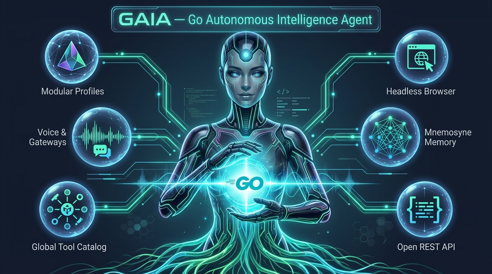
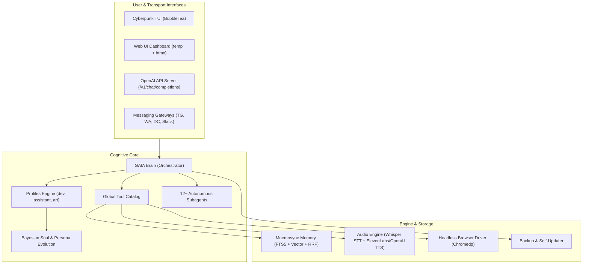

# GAIA — Go Autonomous Intelligence Agent

<p align="center">
  
</p>

[](https://go.dev)
[](https://gaia.facundosalvucci.dev)
[](https://gaia.facundosalvucci.dev/docs)
[](LICENSE)
[](https://github.com/SalvucciFacundo/gaia/releases)
[](https://github.com/SalvucciFacundo/gaia)
[](https://github.com/SalvucciFacundo/gaia/actions)

<p align="center">
  ·
</p>
**GAIA (Go Autonomous Intelligence Agent)** is an enterprise-grade, single-binary autonomous AI assistant and software engineering platform built from the ground up in Go.

GAIA couples autonomous agency with strict operational boundaries:
- **Zero External Runtimes**: Compiles into a single, self-contained native binary with embedded SQLite, FTS5, web assets, templates, and migrations.
- **Organic Driven Development (ODD)**: Dynamically scales from quick inline direct execution to multi-subagent teams without context bloat.
- **Decoupled Architecture**: Profiles define cognitive bias and identity (`SOUL.md`), while tools, multi-channel gateways, and audio engines live in a shared, globally configurable catalog.
- **Omnichannel Access**: Interact via interactive Cyberpunk TUI, built-in Web UI Dashboard (`templ` + `htmx`), OpenAI-compatible REST/SSE API, or native messaging gateways (Telegram, WhatsApp Cloud API, Discord, Slack) with bi-directional voice notes.

---

## ⚡ Quick Start

### 1. One-Line Installation

**Linux & macOS:**
```bash
curl -fsSL https://raw.githubusercontent.com/SalvucciFacundo/gaia/main/install.sh | bash
```

**Windows (PowerShell):**
```powershell
iwr -useb https://raw.githubusercontent.com/SalvucciFacundo/gaia/main/install.ps1 | iex
```

### 2. Build from Source

```bash
git clone https://github.com/SalvucciFacundo/gaia.git
cd gaia
go build -o gaia ./cmd/gaia/
./gaia
```

### 3. First Run Wizard

On first launch, GAIA automatically starts an interactive terminal setup wizard:
- Select your primary LLM provider (OpenAI, Anthropic, DeepSeek, Ollama, Groq, OpenRouter, etc.).
- Choose and activate your starting profile (`dev`, `assistant`, `art`).
- Optionally initialize messaging gateways and audio synthesizers.

---

## 🧩 Architectural Foundations

GAIA is built across **60 modular Go packages** adhering to Hexagonal Architecture (Ports and Adapters):



---

## 🌟 Core Architectural Pillars

Click any pillar to explore its dedicated in-depth documentation guide:

### 🎭 [Modular Profiles & Extensible Personas](docs/persona.md)
Profiles define identity and reasoning demeanor (`SOUL.md`), completely decoupled from tool access. Ships with `dev` (software architect), `assistant` (daily assistant), and `art` (visual reasoning), plus support for unlimited user-defined custom profiles with dynamic Bayesian Soul Evolution and real-time Prompt Injection Defense.  
👉 **[Read the Profiles & Persona Guide →](docs/persona.md)**

### 🧰 [Global Tool Catalog & Decoupling](docs/skills.md)
Every tool lives in a central catalog. No tool is hardcoded to a profile: configure any tool for any profile at runtime (`gaia profile tools enable <profile> <tool>`) or declaratively in `config.yaml`. Supports dynamic parameter inspection (`tool_search`, `load_tool`) and autonomous skill learning (`create_skill`, `read_skill`).  
👉 **[Explore Tool Catalog & Skills →](docs/skills.md)**

### 📡 [Multi-Channel Messaging & Voice Engine](docs/gateway.md)
Run GAIA as an autonomous background daemon across Telegram, WhatsApp (Meta Cloud API), Discord, and Slack. Features bi-directional audio with inbound speech-to-text (OpenAI Whisper STT) and outbound speech synthesis (ElevenLabs / OpenAI TTS), plus interactive inline approval buttons for sensitive operations.  
👉 **[Configure Gateways & Voice →](docs/gateway.md)**

### 🌐 [OpenAI-Compatible REST & Streaming API Server](docs/cli.md#server-mode-openai-restsse-api--web-ui)
Drop-in replacement server for OpenAI endpoints (`gaia serve` / `gaia api`) exposing `POST /v1/chat/completions` with JSON and real-time streaming SSE (`text/event-stream`). Connect any existing AI client (Cursor, LibreChat, Open WebUI, Continue) with constant-time Bearer token authentication and configurable CORS.  
👉 **[Inspect Server API & CLI Commands →](docs/cli.md)**

### 🌐 [Headless Browser Automation](docs/architecture.md#package-layout-60-modular-packages)
Embedded headless browser driver powered by `chromedp` with zero-config auto-detection for Chrome, Chromium, Brave, Edge, and Flatpak. Supports complex client-side JavaScript execution, DOM navigation, full-page screenshots, and structured DOM-to-markdown extraction.  
👉 **[Read Browser & Architecture Overview →](docs/architecture.md)**

### 🧠 [Mnemosyne Persistent Memory Engine](docs/architecture.md#mnemosyne-memory-architecture)
Hybrid memory engine combining SQLite FTS5 Full-Text Search with Vector Cosine Similarity via Reciprocal Rank Fusion (RRF). Observations and durable facts are partitioned by project workspace and lifecycle states (`active` vs `needs_review`) with automatic background compaction.  
👉 **[Learn about Memory & Storage →](docs/architecture.md)**

---

## 📋 Complete CLI Command Summary

| Command | Category | Description |
|---|---|---|
| `gaia` | Core | Launches the interactive Cyberpunk TUI |
| `gaia exec "<prompt>"` | Core | Executes prompt in headless batch mode |
| `gaia serve [--port N]` | Server | Starts the OpenAI-compatible REST/SSE API server |
| `gaia gateway [run]` | Gateway | Starts the Telegram, WhatsApp, Discord, Slack daemon |
| `gaia profile [subcommand]` | Profiles | Manage profiles (`list`, `switch`, `enable`, `disable`, `tools`) |
| `gaia profile tools [enable\|disable\|list\|reset]` | Tools | Configure tools enabled for any profile |
| `gaia skill [list\|create\|show\|delete]` | Skills | Manage agent skills |
| `gaia backup [create\|restore\|list]` | Ops | Create or inspect profile backup archives |
| `gaia restore <archive>` | Ops | Restore configuration and databases from archive |
| `gaia update [--check\|--backup]` | Ops | Check for updates and upgrade GAIA binary |
| `gaia doctor` | Diagnostics | Run environment health checks and diagnostics |

---

## 📖 Documentation

> 🌐 **Interactive Documentation Portal:** Browse the full live documentation on **[gaia.facundosalvucci.dev/docs](https://gaia.facundosalvucci.dev/docs)** with real-time search, Mermaid architecture diagrams, and responsive navigation.

Explore the complete guides in the [docs/](docs) directory:

| Topic | Guide |
|---|---|
| **CLI Commands** | [docs/cli.md](docs/cli.md) |
| **TUI & In-Session Commands** | [docs/tui-commands.md](docs/tui-commands.md) |
| **Configuration Reference** | [docs/configuration.md](docs/configuration.md) |
| **Architecture Overview** | [docs/architecture.md](docs/architecture.md) |
| **Unified Ecosystem Master Plan** | [docs/unified-gaia-ecosystem.md](docs/unified-gaia-ecosystem.md) |
| **AGIS to GAIA Porting Guide** | [docs/agis-to-gaia-porting-guide.md](docs/agis-to-gaia-porting-guide.md) |
| **Profiles & Persona System** | [docs/persona.md](docs/persona.md) |
| **Gateways & Voice Engine** | [docs/gateway.md](docs/gateway.md) |
| **Skills Hub** | [docs/skills.md](docs/skills.md) |
| **Subagents System** | [docs/subagents.md](docs/subagents.md) |
| **Security Architecture** | [docs/security.md](docs/security.md) |
| **Context Management Layers** | [docs/context-layers.md](docs/context-layers.md) |
| **Token Efficiency & Memory** | [docs/token-efficiency.md](docs/token-efficiency.md) |
| **Design System** | [docs/design-system.md](docs/design-system.md) |
| **Full Specification** | [SPEC.md](SPEC.md) |

---

## 📊 Technical Specifications

| Characteristic | Specification |
|---|---|
| **Language** | Go 1.23+ |
| **Packages** | 60 internal and cmd packages |
| **Architectural Style** | Hexagonal (Ports & Adapters) |
| **Supported LLMs** | 19 providers (OpenAI, Anthropic, DeepSeek, Ollama, Groq, OpenRouter, etc.) |
| **Database** | Embedded SQLite 3 with FTS5 and Vector Search |
| **Web Server** | Native Go `net/http` with SSE streaming and JSON API |
| **User Interfaces** | BubbleTea TUI, `templ` + `htmx` Web Dashboard, OpenAI API |
| **Gateways** | Telegram, WhatsApp Meta Cloud API, Discord, Slack |
| **Audio Processing** | Whisper STT, ElevenLabs TTS, OpenAI TTS |
| **License** | MIT License |

---

## 🤝 Contributing

Contributions are welcome! Please run test suites before submitting PRs:

```bash
git clone https://github.com/SalvucciFacundo/gaia.git
cd gaia
go test -count=1 ./...
go build ./cmd/gaia
```

---

## 🙏 Acknowledgments

GAIA stands on the shoulders of several open-source projects:
- **[Gentle AI / Gentle Shell](https://github.com/Gentleman-Programming/gentle-ai)** — Core workflow inspiration, Organic Driven Development (ODD), BR review, and Engram memory model.
- **[Hermes Agent](https://github.com/NousResearch/hermes-agent)** — Learning loop, skill creation/improvement, and tool approval system.
- **[ogcode](https://github.com/...)** — Token efficiency and Knowledge Graph recall.
- **[pi-go](https://github.com/...)** — Go-native agent structure.

---

## 📄 License

MIT — see [LICENSE](LICENSE).
