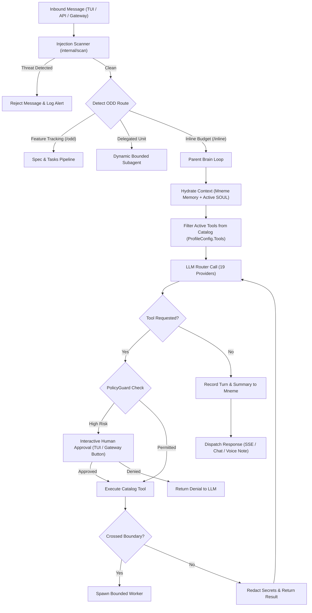
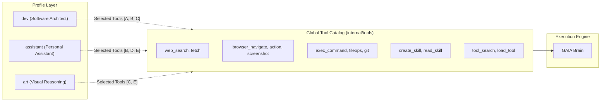
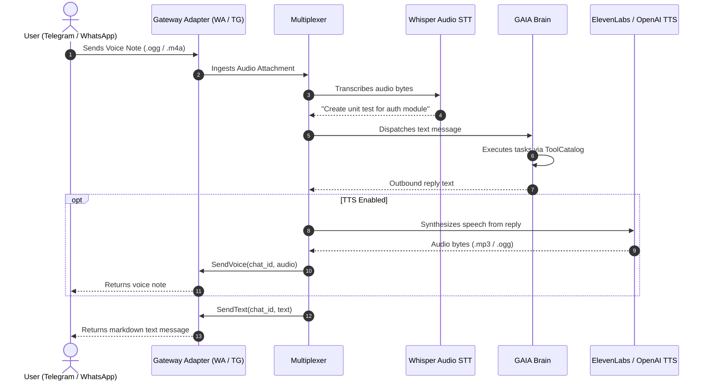
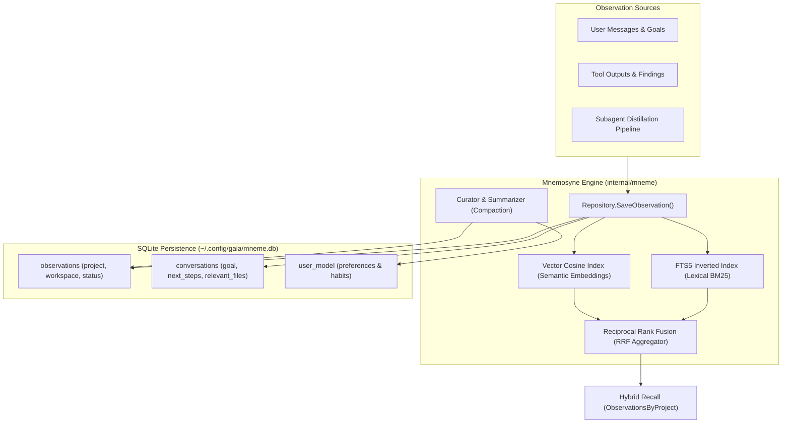

# GAIA System Architecture

GAIA follows a strict **Hexagonal Architecture (Ports and Adapters)** implemented in Go. The core cognitive loop is completely framework-agnostic, with all protocols, storage engines, UI layers, and messaging gateways decoupled behind clean interface boundaries.

---

## 🏛️ High-Level Hexagonal Topology

```mermaid
graph TD
    subgraph Drivers ["Driving Adapters (Primary / Inbound)"]
        TUI["Cyberpunk TUI (BubbleTea)"]
        WEB["Web UI Dashboard (templ + htmx)"]
        API["OpenAI API Server (/v1/chat/completions)"]
        GW["Messaging Gateways (TG, WA, DC, Slack)"]
        CLI["CLI Commands (exec, profile, backup, skill)"]
    end

    subgraph PortsIn ["Inbound Ports"]
        P_Chat["ChatCompletionService"]
        P_Gateway["GatewayEventDispatcher"]
        P_Session["SessionManagementPort"]
    end

    subgraph Core ["Cognitive Core (Hexagon)"]
        Brain["GAIA Brain (Orchestrator)"]
        Profiles["Profiles Engine (dev, assistant, art)"]
        Soul["Bayesian Soul & Persona Evolution"]
        Catalog["Global Tool Catalog"]
        ODD["Organic Driven Development (ODD)"]
        Subagents["12+ Autonomous Subagents"]
        Scanner["Prompt Injection Scanner"]
    end

    subgraph PortsOut ["Outbound Ports"]
        P_LLM["LLMProvider (19 Vendors)"]
        P_Memory["MemoryRepository (Mnemosyne)"]
        P_Audio["AudioTranscriber & Synthesizer"]
        P_Browser["BrowserDriver (Chromedp)"]
        P_Tools["ToolExecutor"]
    end

    subgraph Driven ["Driven Adapters (Secondary / Outbound)"]
        LLM["Router & Credential Pool (OpenAI, Anthropic, DeepSeek, etc.)"]
        MNEME["Mneme Engine (SQLite FTS5 + Vector + RRF)"]
        AUDIO["Audio Adapters (Whisper STT, ElevenLabs / OpenAI TTS)"]
        BROWSER["CLIDriver (Chrome, Brave, Edge, Flatpak)"]
        SYS["System Drivers (FileOps, GitOps, Sandbox Shell)"]
    end

    Drivers --> PortsIn
    PortsIn --> Core
    Core --> PortsOut
    PortsOut --> Driven
```



---

## 📦 Package Layout (60 Modular Packages)

```text
gaia/
├── cmd/gaia/                     # Unified CLI & Daemon Entry Points
│   ├── main.go                   # Command routing & flag dispatch
│   ├── profile.go                # Profile management & tool enablement
│   ├── serve.go                  # OpenAI REST/SSE API server & Web UI
│   ├── gateway.go                # Multi-channel messaging daemon
│   ├── skill.go                  # Skill CRUD & hub inspection
│   ├── backup.go                 # Profile backup & restore
│   ├── update.go                 # Self-updater CLI
│   └── exec.go                   # Headless batch execution
│
├── internal/
│   ├── core/                     # Core Domain, Brain & Modular Execution Kernel
│   │   ├── domain/               # Core data models, configs, tool defs
│   │   ├── ports/                # Hexagonal ports (Transcriber, Synthesizer, LLM)
│   │   ├── kernel.go             # Brain cognitive loop, streaming & tool dispatch
│   │   ├── session_commands.go   # /undo, /retry, /new, /save, /sessions, /resume
│   │   ├── workflow_commands.go  # /goal, /subgoal, /snapshot, /branch, /steer, /background
│   │   ├── config_commands.go    # /model, /fast, /busy, /codegraph, /memory
│   │   ├── info_commands.go      # /insights, /debug, /credits, /billing, /commands
│   │   ├── skill_commands.go     # /learn, /suggestions, /blueprint, /curator
│   │   ├── media_commands.go     # /image, /paste
│   │   ├── integration_commands.go # /sethome, /trust, /session, /kg, /mcp
│   │   ├── registry.go           # ToolRegistry & caching
│   │   ├── policy.go             # PolicyGuard tier enforcement & 4x3 matrix
│   │   └── blocking/             # Human confirmation & interactive envelope guard
│   │
│   ├── profiles/                 # Modular Profiles & Persona Subsystem
│   │   ├── manager.go            # Thread-safe profile manager & tool filter
│   │   ├── assistant.go          # Personal assistant profile definition
│   │   ├── dev.go                # Software architect profile definition
│   │   └── art.go                # Visual & creative profile definition
│   │
│   ├── persona/                  # Bayesian Soul Evolution & Tuning
│   ├── scan/                     # Real-time Prompt Injection Scanner
│   │
│   ├── tools/                    # Global Tool Catalog & Built-in Toolsets
│   │   ├── catalog.go            # ToolCatalog registry & category index
│   │   ├── browser/              # Headless browser automation (chromedp driver)
│   │   ├── web/fetch/            # SSRF-guarded fetch & HTML-to-Markdown
│   │   ├── web/search/           # Multi-provider web search (DDG, Brave, SearXNG)
│   │   ├── create_skill.go       # Autonomous skill creation tool
│   │   ├── read_skill.go         # Autonomous skill inspection tool
│   │   ├── tool_search.go        # Dynamic tool search in catalog
│   │   └── load_tool.go          # Lazy tool parameter inspection
│   │
│   ├── mneme/                    # Mnemosyne Persistent Memory Engine
│   │   ├── migrations/           # SQLite migrations (0001 to 0008)
│   │   ├── sqlite.go             # SQLite connection & CRUD repository
│   │   ├── fts.go                # SQLite FTS5 Full-Text Search
│   │   ├── vector.go             # Vector cosine similarity
│   │   ├── rrf.go                # Reciprocal Rank Fusion hybrid search
│   │   ├── hybrid.go             # Combined FTS + Vector retriever
│   │   ├── usermodel.go          # User model & durable preferences
│   │   ├── curator.go            # Background memory compaction & distillation
│   │   └── summarizer.go         # Turn-level session summarization
│   │
│   ├── server/                   # OpenAI-Compatible REST & SSE Server
│   │   ├── server.go             # HTTP server with graceful shutdown
│   │   ├── chat.go               # /v1/chat/completions (JSON & SSE stream)
│   │   ├── auth.go               # Constant-time Bearer token verification
│   │   ├── cors.go               # Configurable CORS middleware
│   │   └── types.go              # OpenAI DTOs & chunk structures
│   │
│   ├── gateway/                  # Multi-Platform Messaging Gateways
│   │   ├── multiplexer.go        # Cross-gateway message & audio multiplexer
│   │   ├── telegram.go           # Telegram Bot API adapter
│   │   ├── whatsapp.go           # WhatsApp Meta Cloud API & webhooks
│   │   ├── discord.go            # Discord Bot gateway adapter
│   │   ├── slack.go              # Slack Events API & Socket Mode
│   │   ├── media.go              # Magic-byte media ingest & validation
│   │   └── approver.go           # Interactive inline approval gates
│   │
│   ├── adapters/
│   │   ├── audio/                # Multi-Provider Audio Processing Engine
│   │   │   ├── factory.go        # Transcriber & Synthesizer factory
│   │   │   ├── whisper.go        # OpenAI Whisper STT client
│   │   │   ├── elevenlabs.go     # ElevenLabs TTS client
│   │   │   └── openai.go         # OpenAI TTS client
│   │   ├── llm/                  # 19 LLM Provider Router & Credential Pool
│   │   ├── tui/                  # BubbleTea Cyberpunk TUI & Lipgloss diffs
│   │   └── web/views/            # Web UI Dashboard (templ + TailwindCSS)
│   │
│   ├── subagents/                # Ephemeral Worktrees & Distillation
│   ├── session/                  # Multi-Channel Conversation Sessions
│   ├── backup/                   # Manifest-Backed TAR Backup & Restore
│   ├── updater/                  # GitHub Release Self-Updater with SemVer
│   ├── version/                  # SemVer comparison & build metadata
│   └── modules/                  # System Modules (shell, fileops, gitops)
```

---

## 🧠 The Agent Loop (Brain & ODD Pipeline)

`internal/core/kernel.go` orchestrates execution using **Organic Driven Development (ODD)**:



---

## 🧰 Global Tool Catalog & Profile Decoupling

GAIA strictly separates **Identity** from **Capabilities**:



- Each profile suggests a baseline toolset, but the user can enable or disable **any** tool for **any** profile at runtime via `gaia profile tools enable <profile> <tool>` or declaratively via `config.yaml`.
- The Brain dynamically routes requested tool calls through the `ToolCatalog` using thread-safe execution handlers.

---

## 📡 Multi-Channel Gateway & Audio Multiplexer

The messaging gateway architecture enables simultaneous bi-directional interaction across Telegram, WhatsApp, Discord, and Slack:



---

## 🧠 Mnemosyne Memory Architecture



---

## 🛡️ Security, Review & PolicyGuard

1. **PolicyGuard (`internal/core/policyguard/`)**:
   - Three operational tiers: `read`, `sandbox`, `full`.
   - Denies destructive commands (`rm -rf /`, raw disk formatting, unsafe credentials exposure) and escalates overrides to human confirmation.
2. **Interactive Approver (`internal/gateway/approver.go`)**:
   - Out-of-band interactive approval over Telegram/WhatsApp for dangerous tool operations using inline keyboard buttons.
3. **4R Review Engine (`internal/review/`)**:
   - Receipt-Driven Development evaluating 4 lenses: **Risk**, **Resilience**, **Readability**, and **Reliability**.
   - Generates cryptographically sealed SHA256 CAS receipts enforced at `pre-commit` and `pre-push` Git hooks.

