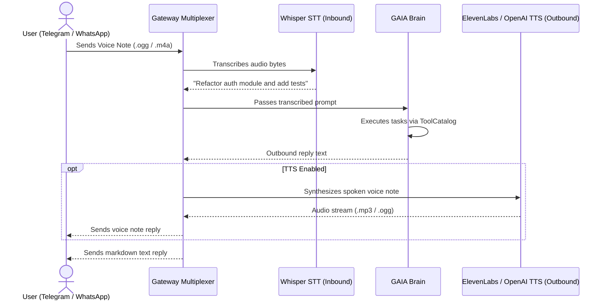

# Multi-Channel Messaging Gateways & Voice Engine

GAIA can run as an autonomous, multi-channel background daemon communicating concurrently over Telegram, WhatsApp, Discord, and Slack, with integrated bi-directional voice transcription and speech synthesis.

---

## 🚀 Running the Gateway Daemon

Launch the multi-channel gateway service:

```bash
# Start gateway daemon using default ~/.config/gaia/config.yaml
gaia gateway run

# Or provide explicit config file
gaia gateway run --config /path/to/custom-config.yaml
```

---

## 📡 Supported Messaging Adapters

### 1. Telegram (`internal/gateway/telegram.go`)
- **Transport**: Real-time long polling or webhook listener.
- **Security**: Allowlist of Telegram user IDs / usernames.
- **Media Ingestion**: Audio notes, photos, and documents validated via magic bytes.
- **Voice Output**: Returns synthesized audio notes using Telegram's native voice format.

### 2. WhatsApp Meta Cloud API (`internal/gateway/whatsapp.go`)
- **Transport**: Official Meta Cloud API over HTTPS with webhook challenge verification.
- **Security**: Cryptographic HMAC-SHA256 payload verification (`X-Hub-Signature-256`) using your Meta App Secret.
- **Phone Scoping**: Allowlist of E.164 phone numbers.
- **Voice Output**: Sends OGG/Opus audio voice notes directly to WhatsApp chats.

### 3. Discord (`internal/gateway/discord.go`)
- **Transport**: Discord Bot Gateway WebSocket connection.
- **Channel Scoping**: Guild and channel ID filtering.
- **Attachments**: Downloads and parses images, text files, and audio clips.

### 4. Slack (`internal/gateway/slack.go`)
- **Transport**: Slack Events API or Socket Mode.
- **Security**: Slack request signing secret verification.

---

## 🎙️ Audio Processing Engine (`internal/adapters/audio/`)

GAIA provides seamless speech-to-speech interaction:



### Inbound STT (Speech-to-Text)
- Uses **OpenAI Whisper** (`whisper-1`) with automatic MIME-type detection and file streaming.
- Supports voice notes in Spanish, English, Portuguese, and 50+ languages.

### Outbound TTS (Text-to-Speech)
- **OpenAI TTS**: High-speed, natural voices (`alloy`, `echo`, `fable`, `onyx`, `nova`, `shimmer`).
- **ElevenLabs**: Ultra-expressive voice cloning and studio-quality voices.

---

## 🛡️ Interactive Approval Gates (`internal/gateway/approver.go`)

When running in gateway mode, operations requiring human authorization (e.g. executing dangerous shell commands or modifying files in `read` tier) generate an interactive card:

1. The gateway dispatches an authorization prompt with **[Approve]** and **[Deny]** inline buttons to the authorized chat.
2. The agent pauses its execution turn and waits for the user's decision.
3. Execution resumes immediately upon receiving the authorized callback query.

---

## ⚙️ Configuration Reference

In `~/.config/gaia/config.yaml`:

```yaml
gateway:
  enabled: true

  telegram:
    enabled: true
    token: "YOUR_TELEGRAM_BOT_TOKEN"
    allowlist:
      - "123456789"

  whatsapp:
    enabled: true
    api_token: "META_CLOUD_API_TOKEN"
    phone_number_id: "10987654321"
    verify_token: "MY_WEBHOOK_VERIFY_TOKEN"
    app_secret: "META_APP_SECRET"
    listen_addr: ":3003"
    allowed_users:
      - "+5491112345678"

multimodal:
  audio:
    enabled: true
    provider: "openai"
    model: "whisper-1"

tts:
  enabled: true
  provider: "openai"
  voice: "alloy"
```
