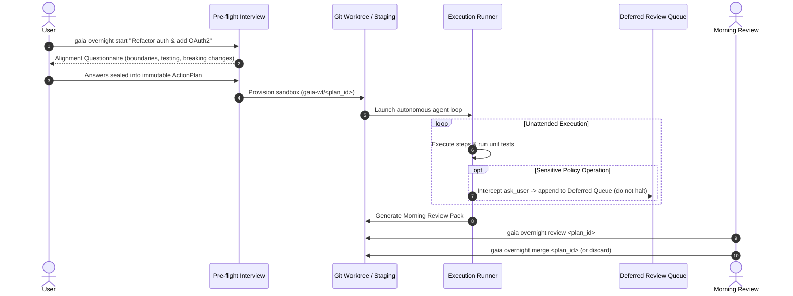

# Overnight Autonomous Execution & Sandboxed Review

GAIA supports unattended, multi-stage autonomous execution across all profiles (`dev`, `assistant`, `art`, etc.). This feature allows GAIA to execute long-running engineering, research, or content creation tasks overnight without stalling for human confirmation, presenting a single consolidated review before any change is merged or published.

---

## 🌙 Autonomous Execution Lifecycle



---

## 🛡️ Four Safeguards for Safe Unattended Operation

### 1. Pre-Flight Alignment Questionnaire (`internal/overnight/preflight.go`)
Before the user steps away, GAIA analyzes the prompt and triggers an interactive interview:
- **Architectural Constraints**: Identify non-negotiable libraries or patterns.
- **Breaking Changes Policy**: Explicitly allow or forbid modifications to public interfaces.
- **Verification Criteria**: Required test commands and coverage standards.
Answers are sealed into an immutable `ActionPlan` persisted in SQLite.

### 2. Multi-Profile Sandboxing (`internal/overnight/runner.go`)
Unattended execution never modifies the active working tree directly:
- **Git Repositories**: GAIA provisions an isolated **Git Worktree** under `.gaia/worktrees/<plan_id>` on an isolated branch (`gaia-wt/<plan_id>`).
- **Non-Git Projects**: GAIA provisions an isolated staging directory under `.gaia/staging/<plan_id>`.

### 3. Non-Blocking Deferred Review Queue (`internal/overnight/deferred_queue.go`)
Normally, sensitive operations (file deletions, external network calls, schema drops) prompt the user via `PolicyGuard`. During overnight runs:
- `PolicyGuard`'s `ask_user` actions are intercepted and appended to an append-only SQLite log (`overnight_deferred_actions`).
- Execution proceeds in the sandbox, deferring the confirmation gate to the morning review without blocking the loop.

### 4. Consolidated Morning Review Pack (`internal/overnight/types.go`)
Upon waking, the user runs `gaia overnight review <plan_id>` to inspect:
- Unified Git diff of all changed files.
- Automated test execution logs.
- Pending deferred actions with explanations and blast radius assessments.
- One-click commands: `gaia overnight merge <plan_id>` or `gaia overnight discard <plan_id>`.

---

## 💻 CLI Commands

```bash
# Start an overnight autonomous task with pre-flight questionnaire
gaia overnight start "Implement Redis cache layer and benchmark throughput"

# List all overnight plans with status (running, completed, reviewed)
gaia overnight list

# Inspect detailed review pack, diffs, and deferred actions
gaia overnight review plan_1729272300

# Apply/merge validated worktree changes into main branch
gaia overnight merge plan_1729272300

# Discard sandbox and worktree cleanly
gaia overnight discard plan_1729272300
```
