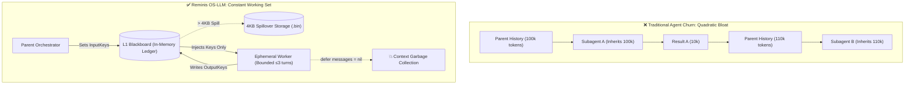

# Reminis Integration & Blackboard Working Memory Engine

GAIA integrates the **OS-LLM architecture** and memory patterns originally conceived in Facundo Salvucci's [**Reminis**](https://github.com/SalvucciFacundo/Reminis) project. 

This engine eliminates the quadratic context explosion problem ($O(N^2)$) inherent in multi-turn, multi-agent LLM systems by replacing bulky conversation replay with a **pure Go, thread-safe L1 working memory ledger**, automatic **pass-by-reference disk spillover**, and **ephemeral subagents with complete conversational context destruction**.

---

## 💥 The $O(N^2)$ Multi-Agent Context Dilemma

In traditional multi-agent systems, every subagent spawned inherits the parent agent's message history. As subagents converse, call tools, and return responses:
1. **Context Window Inflation**: Each subagent's token usage multiplies with the length of the parent conversation.
2. **Exponential Cost & Latency**: Processing $M$ messages across $K$ subagents results in $O(M \cdot K)$ token churn per turn, quickly saturating context windows and degrading model attention.
3. **No Central Truth**: State shared between subagents must be re-stated in prompt text, creating inconsistencies and hallucinations.



---

## 🏛️ Reminis Architecture Pillars in GAIA

### 1. Blackboard Working Memory (`internal/blackboard/`)
The **Blackboard** is a concurrent, in-memory key-value ledger guarded by a fine-grained `sync.RWMutex`:
- **Fast L1 Access**: Nanosecond in-memory reads and writes for inter-agent communication and intermediate state.
- **Namespace Isolation**:
  - `tasks.<producer_id>.*`: Scoped working state private to the producing subagent.
  - `global.*`: Shared system-wide keys readable across all profiles and subagents.
- **Thread-Safety**: Concurrently accessed by parallel subagents and tool execution threads without race conditions (`-race` verified).

### 2. Automatic 4KB Disk Spillover (Pass-by-Reference)
Large payloads (source files, compilation dumps, large API responses) threaten to consume working memory and prompt budgets:
- When any value stored on the Blackboard exceeds **4 KB** (`4096 bytes`), GAIA automatically writes the raw payload to disk under `.gaia/spillover/<key_hash>.bin`.
- The Blackboard stores an `Entry` containing `IsSpillover: true` and the local file path.
- LLM prompts receive the lightweight reference and snippet rather than megabytes of raw text. Consumers retrieve the full payload on demand via `blackboard_get`.

### 3. Ephemeral Subagents & Conversational Context Destruction
GAIA subagents configured as `Ephemeral` run with strict OS-LLM discipline:
- **Zero Parent History Inheritance**: Ephemeral subagents do NOT receive the parent session's chat transcript.
- **Input Keys Resolution**: Before execution, the subagent spawner reads explicitly requested `InputKeys` from the Blackboard and injects them as clean context facts.
- **3-Turn Hard Bound**: The subagent loop is constrained to a maximum of 3 tool execution turns.
- **Output Flushed to Blackboard**: The worker's final result is automatically registered under `tasks.<task_id>.output`.
- **Immediate Context Destruction**: Upon return, the subagent's message slice is immediately cleared (`defer func() { messages = nil }()`), allowing the Go garbage collector to instantly reclaim memory.

---

## 🔒 Cryptographic Security Snapshots (SHA-256)

To protect agent state and enable rollback, GAIA provides tamper-evident Blackboard Snapshots backed by SQLite:
- **Atomic Serialization**: Snapshots serialize the active Blackboard entries into a structured payload.
- **Cryptographic Checksum**: Calculates a **SHA-256 hash** of the snapshot contents at creation time.
- **Tamper Verification**: When inspecting or restoring a snapshot, GAIA recalculates the SHA-256 hash against the database record. If any byte was altered, restoration is immediately rejected.

### CLI Management
```bash
# List all snapshots with timestamps and SHA-256 prefixes
gaia blackboard snapshot list

# Inspect snapshot contents and verify SHA-256 integrity
gaia blackboard snapshot inspect snap_1729272300

# Restore snapshot state into active Blackboard memory
gaia blackboard snapshot restore snap_1729272300
```

---

## 🛠️ Blackboard Tool Catalog

| Tool Name | Parameters | Description |
|---|---|---|
| `blackboard_get` | `key` | Retrieve an entry from the Blackboard (automatically transparent for spilled values). |
| `blackboard_set` | `key`, `value` | Store or update a value on the Blackboard (triggers 4KB spillover if payload $> 4\text{ KB}$). |
| `blackboard_list` | `prefix` | List keys matching a namespace prefix (e.g., `tasks.`, `global.`). |
| `blackboard_snapshot` | `label` | Atomically persist current working memory to SQLite with SHA-256 verification. |

---

## 🔗 Provenance & Credits
The Reminis OS-LLM architecture was created by **Facundo Salvucci**:
- Repository: [https://github.com/SalvucciFacundo/Reminis](https://github.com/SalvucciFacundo/Reminis)
- Concept: OS-like separation between Working Memory (RAM/Blackboard), Disk Spillover (Virtual Memory), and Ephemeral Processes (Subagents with bounded lifecycles).
