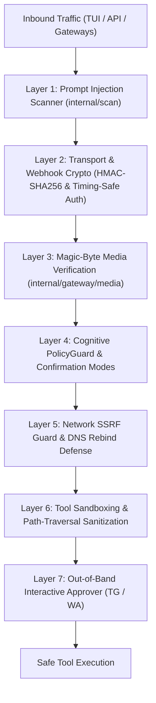

# GAIA Security Model & Defense in Depth

GAIA is an autonomous agent with broad local filesystem, terminal, and network capabilities. To ensure safe operation in mission-critical environments, GAIA employs a **multi-layered Defense in Depth architecture**:



---

## 🛡️ Multi-Layer Security Architecture

### Layer 1: Real-Time Prompt Injection Defense (`internal/scan/`)
Every inbound message from any source is scanned before reaching the Brain:
- **Jailbreak Mitigation**: Detects adversarial roleplays, simulation traps, and DAN-style bypasses.
- **System Prompt Exfiltration Protection**: Identifies attempts to dump internal instructions, `SOUL.md` weights, or configuration tokens.
- **Indirect Prompt Injection Scanner**: Scans third-party content (scraped web pages, Git commits, fetched issues) to prevent remote instructions from taking over the agent loop.

### Layer 2: Cryptographic Transport & Constant-Time Auth
- **OpenAI API Server (`internal/server/auth.go`)**: Validates Bearer tokens using `subtle.ConstantTimeCompare` to completely neutralize timing attack vectors.
- **WhatsApp Meta Cloud API (`internal/gateway/whatsapp.go`)**: Verifies HMAC-SHA256 payload signatures against the configured Meta App Secret (`X-Hub-Signature-256`) before parsing incoming webhook events.

### Layer 3: Magic-Byte Media Ingestion (`internal/gateway/media.go`)
Attachments received over Telegram, WhatsApp, Discord, or Slack are not trusted by file extension alone:
- **File Signature Inspection**: Ingested files are validated against their initial magic bytes to verify genuine audio (`audio/ogg`, `audio/mpeg`, `audio/mp4`), images (`image/png`, `image/jpeg`, `image/webp`), and documents.
- **Spoofing Prevention**: Prevents executable binaries or polyglot scripts disguised with image or audio extensions from reaching downstream transcription or vision pipelines.

### Layer 4: PolicyGuard Security Tiers (`internal/core/policyguard/`)
PolicyGuard enforces workspace-level boundaries:

| Tier | Filesystem Scope | Allowed Tool Operations | Target Environment |
|---|---|---|---|
| **`read`** | Read-only | File reading, AST search, code review | Security auditing, unfamiliar codebases |
| **`sandbox`** | Current workspace only | Gated tools and shell allowlist; paths locked to repo | Standard engineering, feature dev |
| **`full`** | System-wide | Unrestricted shell and file modification | Trusted local workstation |

Initialize workspace tier:
```bash
gaia policy init --tier=sandbox
```

### Layer 5: SSRF Guard & DNS Rebind Mitigation (`internal/tools/web/fetch/`)
The web fetch tool implements rigorous Server-Side Request Forgery defenses:
- **Private IP Blocking**: Prohibits requests to `127.0.0.1`, `::1`, RFC 1918 subnets (`10.0.0.0/8`, `172.16.0.0/12`, `192.168.0.0/16`), link-local IPs (`169.254.0.0/16`), and AWS metadata endpoints (`169.254.169.254`).
- **DNS Resolution Pinning**: Resolves domain IPs and validates every returned IP address before establishing connections, preventing DNS rebinding exploits.

### Layer 6: Path Traversal Sanitization & Backup Integrity (`internal/backup/`)
- **Archive Extraction Protection**: The restore subsystem inspects every archive path, rejecting any target containing `..`, absolute root paths, or symlink targets pointing outside the profile directory.
- **Cryptographic Manifest Verification**: Backups include a signed manifest with SHA256 hashes and file permissions. Restore aborts immediately upon any checksum mismatch.

### Layer 7: Out-of-Band Interactive Approver (`internal/gateway/approver.go`)
When running as a headless daemon over Telegram or WhatsApp, operations requiring human authorization generate an **Interactive Approval Gate**:
- The agent pauses execution and transmits an inline authorization card with **[Approve]** and **[Deny]** buttons directly to the authorized user's chat.
- Execution resumes only after a cryptographically authorized click from an allowlisted user ID.

---

## 🔑 Secret Redaction & Key Protection

| Vector | Mitigation |
|---|---|
| Keys leaked in chat history | Automatic redaction of `sk-*`, `ghp_*`, `github_pat_*`, `Bearer *`, and custom token regexes from all inbound and outbound streams. |
| Keys leaked in tool logs | The logging middleware scrubs all environment variables, stdout, and stderr streams before persisting or presenting turns. |
| Subagent secret scoping | Subagents run in isolated environments receiving only authorized environment variables. |

---

## 🚦 Interaction Trust Modes

Configure confirmation behavior in `config.yaml` or change dynamically in session:

| Mode | Behavior |
|---|---|
| **`interactive`** (default) | Prompts for confirmation before executing any state-changing or high-risk tool. |
| **`always`** | Prompts before every shell command or file edit. |
| **`session`** | Prompts once for permission; remembers authorization for the duration of the current session. |
| **`never` (YOLO)** | Never prompts; executes autonomously (intended strictly for isolated CI/CD containers). |

Switch trust modes dynamically in the TUI:
```text
/trust session    → Trust operations for this session
/trust always     → Require human approval for all actions
/trust once       → Approve only the next immediate tool call
```

