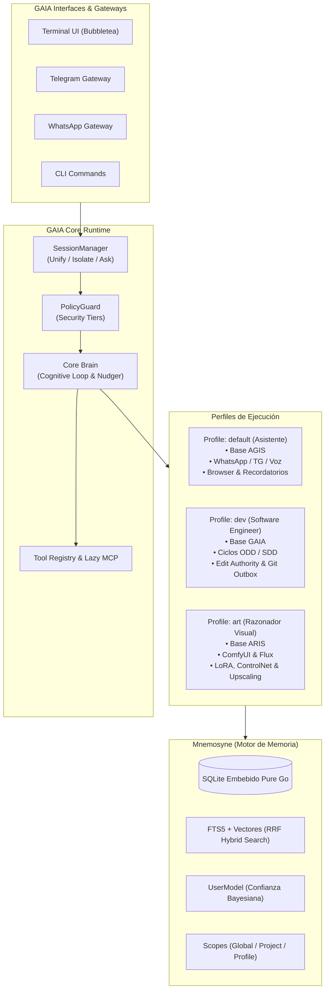

# Unified GAIA Architecture: Multi-Profile Agent & Memory Engine

Este documento define la arquitectura integral para la consolidación del ecosistema **GAIA**, integrando las capacidades de asistente general de **AGIS**, el motor de ingeniería de software autónomo de **GAIA**, y el motor creativo visual de **ARIS** bajo una plataforma unificada basada en perfiles y un motor de memoria de alta fidelidad.

---

## 1. Análisis del Nombre "Synapse" y Alternativas

### 1.1 Estado de "Synapse" en el Ecosistema Open Source
Una verificación en repositorios y literatura técnica muestra que **"Synapse" está altamente saturado** en el nicho de memoria y agentes de IA:
- **`Synapse-OSS` (UpayanGhosh)**: Asistente personal self-hosted con memoria RAG híbrida, "Soul-Brain Sync" y soporte multicanal (WhatsApp, Telegram).
- **`Synapse (Coding Assistant Memory)`**: Servidor API self-hosted para agregar memoria persistente a Cursor, Cline y Continue.
- **`zai-org/Synapse`**: Framework de espacios de trabajo colaborativos de IA.
- **`synapse-memory` (npm)**: Capa de caché semántica y persistencia en SQLite para LLMs.
- **`Matrix Synapse`**: El servidor de mensajería federada más conocido del ecosistema.

### 1.2 Alternativas Recomendadas
Para evitar colisiones de marca y mantener una identidad mitológica y conceptual coherente con **GAIA**:

1. **`Mnemosyne` (Display) / `mneme` (Código Interno)** *(Decisión adoptada)*: 
   - Nombre de cara al usuario / documentación: **Mnemosyne**.
   - Nombre técnico en Go: paquete `mneme` (`internal/mneme` o `internal/memory/mneme`). Corto, idiomático y sin colisiones.
   - **Conexión genealógica**: Mnemosyne es literalmente **hija de Gaia (Gea)** y Urano en la mitología griega, encajando como subsistema hijo de GAIA.
2. **`Gaia Cortex`**: 
   - Directo, técnico y sobrio. Representa la corteza cerebral donde convergen la memoria episódica, la percepción y el razonamiento.
3. **`Anamnesis`**:
   - Concepto filosófico platónico sobre la reminiscencia y la capacidad del alma de recordar la verdad intrínseca.

---

## 2. Visión del Ecosistema GAIA

GAIA se consolida como una **plataforma única, modular y auto-contenida en Go**, eliminando la duplicación de código (clientes LLM, parsing de herramientas, protocolos de red, interfaces TUI) entre tres proyectos separados.



---

## 3. Especificación del Motor de Memoria (`Mnemosyne`)

El motor de memoria toma la implementación autónoma de AGIS (`internal/memory`) como base y la expande con las capacidades críticas de **Engram** para dar soporte completo tanto a desarrollo como a asistencia personal.

### 3.1 Lo que aporta la base de AGIS (Asistente)
- **Zero-Dependency**: SQLite estático en Go puro sin requerir daemons externos.
- **Curador en tiempo real (`Nudge`)**: Extracción automática de observaciones cada *N* turnos sin intervención del usuario.
- **Búsqueda Híbrida de Alta Precisión**: FTS5 (`unicode61` insensible a acentos) + embeddings vectoriales fusionados mediante Reciprocal Rank Fusion (RRF).
- **Modelo de Usuario Continuo (`user_model`)**: Fusión de datos personales con ponderación bayesiana ($conf = 0.7 \times old + 0.3 \times new$).
- **Destilación de Skills (`SkillCreator`)**: Generación de habilidades reutilizables al cierre de sesión.

### 3.2 Mejoras requeridas de Engram (Desarrollo & Proyectos)

Para que `Mnemosyne` soporte perfectamente el trabajo de `gaia-dev`, se define la migración `0008`:

#### A. Aislamiento por Proyecto y Espacio de Trabajo
- Las observaciones técnicas deben vincularse al repositorio o directorio de trabajo activo (`workspace_dir` / `project`), evitando que las reglas o bugs de un proyecto contaminen el contexto de otro.
- Soporte para scope global (`scope = "global"` o `scope = "user"`) para preferencias personales, y scope local (`scope = "project"` con `project_name = "gaia"`).

#### B. Ciclo de Vida y Validez de Observaciones (`status`)
- Columna `status` con valores `active` y `needs_review`.
- Permite detectar conocimientos obsoletos cuando una base de código sufre refactorizaciones mayores.

#### C. Resumen Estructurado de Sesión de Desarrollo
- La tabla de eventos de sesión o resúmenes de conversación almacena el payload canónico de sesión dev:
  - `goal`: Objetivo de la sesión.
  - `discoveries`: Hallazgos técnicos no triviales.
  - `accomplished`: Tareas finalizadas.
  - `next_steps`: Tareas pendientes para la próxima sesión.
  - `relevant_files`: Mapa JSON `path -> descripción` de archivos afectados.

---

### 3.3 Esquema SQL Propuesto (Migración `0008_mnemosyne_upgrade.sql`)

```sql
-- Agregar soporte de proyectos y ciclo de vida a las observaciones
ALTER TABLE observations ADD COLUMN project TEXT NOT NULL DEFAULT 'global';
ALTER TABLE observations ADD COLUMN workspace_dir TEXT NOT NULL DEFAULT '';
ALTER TABLE observations ADD COLUMN status TEXT NOT NULL DEFAULT 'active' CHECK (status IN ('active', 'needs_review'));

CREATE INDEX idx_observations_project_status ON observations(project, status);

-- Extender resumen de sesiones con metadatos estructurados
ALTER TABLE conversations ADD COLUMN goal TEXT NOT NULL DEFAULT '';
ALTER TABLE conversations ADD COLUMN next_steps TEXT NOT NULL DEFAULT '';
ALTER TABLE conversations ADD COLUMN relevant_files TEXT NOT NULL DEFAULT '{}';
```

---

## 4. Hoja de Ruta de Implementación

1. **Fase 1: Motor de Memoria `Mnemosyne`**:
   - Portar `internal/memory` de AGIS hacia GAIA bajo el namespace `internal/memory/mnemosyne`.
   - Aplicar la migración `0008` (proyectos, ciclo de vida `active`/`needs_review`, resúmenes estructurados).
   - Mantener compatibilidad con el exportador de Engram para backup en VPS.
2. **Fase 2: Arquitectura de Perfiles (`internal/profiles`)**:
   - Diseñar el cargador de manifiestos `profiles.yaml`.
   - Crear los 3 perfiles estándar: `default` (AGIS Asistente), `dev` (GAIA Coder), `art` (ARIS Visual).
   - Aislar toolsets y prompts de sistema según el perfil activo.
3. **Fase 3: Integración de Tools de AGIS y ARIS**:
   - Incorporar herramientas de voz (TTS/STT), headless browser y curador al Core.
   - Incorporar adaptador de ComfyUI, LoRA manager y generación de imágenes al paquete `internal/tools/art`.
4. **Fase 4: TUI & Gateway Multi-Perfil**:
   - Permitir selección de perfil en la TUI (`gaia -p dev` o comando `/profile use art`).
   - Soportar bots independientes por plataforma (ej. bot de Telegram para asistente y bot para dev).

---

## 5. Gestión de Perfiles y Experiencia de Usuario (UX)

### 5.1 Selección en Instalación y Persistencia
- **Onboarding Interactivo (`gaia init`)**: Durante el wizard inicial, el usuario elige su perfil predeterminado (`default_profile: assistant | dev | art`).
- **Persistencia**: Se guarda en `~/.gaia/config.yaml`.
- **Flexibilidad**: El usuario puede alternar el predeterminado en cualquier momento con `gaia profile set-default <name>` o usar un perfil temporal con `gaia -p <name>`.
- **Extensibilidad**: La arquitectura de perfiles (`internal/profiles/`) está preparada para registrar nuevos perfiles especializados a futuro sin modificar el kernel.

### 5.2 Claridad y Transparencia para el Usuario
- **Explicación Clara de Permisos**: La interfaz debe explicar en lenguaje accesible (humano, sin tecnicismos opacos) qué permisos solicita cada herramienta y qué nivel de PolicyGuard está activo.
- **Transparencia en Cambios**: Cada edición de archivo, ejecución de comando o acción externa debe mostrar resúmenes comprensibles para que usuarios no técnicos comprendan exactamente el impacto antes de autorizar.
